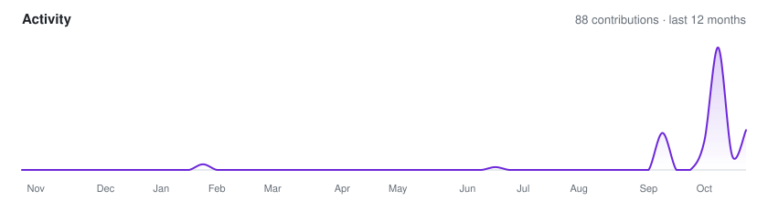

### Hi, I'm Voidlesh 👋

I'm a developer from Germany. I mostly build things for the communities I'm part of —
Discord bots that keep servers running and Fabric mods for Minecraft SMPs.
Most of my work lives in private repos, but here's a glimpse.

- **Currently:** a Fabric client mod for HugoSMP and a few Discord bots with web dashboards
- **Stack:** TypeScript · Java · Swift · Node.js
- **Reach me:** Discord — `voidlesh`

#### Projects

- [**HugoSMPEnhanced**](https://github.com/Voidlesh/HugoSMPEnhanced) — unofficial Fabric client mod for HugoSMP.net
- [**teamchat**](https://github.com/Voidlesh/teamchat) — team chat plugin for Waterfall/BungeeCord networks
- [**MinecraftServerStatus**](https://github.com/Voidlesh/MinecraftServerStatusPrivat) — Discord bot that shows live Minecraft server stats

#### Activity

<picture>
  <source media="(prefers-color-scheme: dark)" srcset="assets/activity-dark.svg">
  
</picture>
